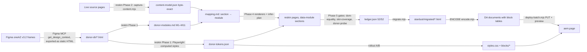

# Benchmark report — Fort Street High School → AEM EDS, reskinned to Figma oneAZ v3.2

| | |
|---|---|
| Source site | https://fortstreet-h.schools.nsw.gov.au/ (52 pages) |
| Design source | Figma **One-AZ v3.2** — `rsZQmpVzuyn0KhCDA3WN60`, node `6400-21997` |
| Tooling | **stardust, adobe/skills `main` @ `cf07727` (v0.34.1) only** — `stardust` → `reskin` → `migrate` → `deploy`/`rollout`; DA block library via the user-supplied excat `block-library-creator` skill. No `figma-to-eds`, no custom converter (the one agent-written step, ENCODE, is a recorded named deviation — § 7). |
| Branch | `fs-oneaz` (GitHub `sanyasandal/stardust_Figma_Migration`) |
| **EDS preview (home)** | **https://fs-oneaz--stardust-figma-migration--sanyasandal.aem.page/fortstreet/** |
| DA content | https://da.live/#/sanyasandal/stardust-figma-migration/fortstreet |
| DA block library | https://da.live/#/sanyasandal/stardust-figma-migration/library/blocks (sheet: `library/blocks.json`) |
| Model | Claude Opus 5.5 (`claude-opus-5.5`), GitHub Copilot CLI 1.0.95-3, hands-off |

## 1. Results at a glance

| Metric | Result | How / source |
|---|---|---|
| **Fidelity — design (stardust target vs EDS page)** | **80.9 %** (range 63.6–92.6) | shift-tolerant composite, 7 pages × 2 viewports (§ 2) |
| &nbsp;&nbsp;desktop 1440 / mobile 390 | 85.2 % / 76.6 % | same |
| &nbsp;&nbsp;strict variant (full-page SSIM) | 69.9 % (range 61.1–79.0) | penalises accumulated vertical drift |
| **Fidelity — original page vs EDS (visual)** | **57.8 %** (range 46.6–75.3) | *expected low: reskin replaces the design on purpose*; strict 52.7 % |
| **Fidelity — content (original text vs EDS text)** | **97.0 %** (range 94.8–99.9) | word-sequence match of `<main>` |
| Figma token conformance (EDS computed styles) | **17 / 17** | `tokens.mjs` on live EDS preview |
| Pages migrated / delivered to DA | **52 / 52**; DA **54 / 54** (+ nav, footer) | `deploy-batch` ledger |
| Blocks | 8 site blocks (hero, cards, teaser, accordion, table, embed, header, footer) + library | § 3 |
| Input tokens | **85,474,456** (cache read 83,074,307; cache write 2,398,719) | recorded |
| Output tokens | **572,764** (incl. 140,754 reasoning) | recorded |
| Cost — Copilot AI credits | **4,007** | recorded (`total_nano_aiu`) |
| Cost — USD | **≈ $71 — ESTIMATE** | not recorded; list-price estimate |
| Time — elapsed | **3 h 28 min** (10:39 → 14:07 UTC) | first → last model request |
| Time — model | 1 h 42 min | sum of request durations |
| Prompts | 15 user prompts; system prompt **not available** | [`prompts.md`](prompts.md) |
| Model requests | 669 (40 by sub-agents) | recorded |

## 2. Fidelity

### 2.1 How it was measured

- Playwright (Chromium 141, headless, DPR 1), full-page screenshots after a slow scroll (lazy images loaded), **same viewport for every pair: 1440×900 desktop and 390×844 mobile**.
- 7 pages = the home page + one page per archetype family: `/`, `/about-us`, `/about-us/enrol`, `/about-us/hsc-results`, `/learning-and-support/wellbeing`, `/school-life/events`, `/contact-us`.
- Three comparisons per page and viewport:
  1. **Design fidelity — stardust reskin target vs EDS page.** The target is the gated static page from `stardust/migrated/` (content byte-gated against the live source, design probe-gated against the Figma tokens). This is the "did EDS reproduce the migration output" number.
  2. **Source vs EDS (visual).** Original live page vs migrated EDS page. A reskin *changes the design on purpose*, so this is expected to be low; it is reported because the brief asks for original-vs-migrated similarity.
  3. **Content fidelity — source text vs EDS text.** Word-sequence match (difflib) of `<main>` text.
- Visual metric (`stardust/.work/fidelity/metrics.py`, PIL + numpy): images resized to 240 px wide, greyscale, shorter page padded white.
  `fidelity % = 40 % structure (SSIM) + 20 % pixel (1 − mean abs diff) + 20 % colour-histogram overlap + 20 % page-length ratio`.
  Two structure variants are reported: **strict** (8×8-window SSIM over the whole page — any early height difference misaligns everything below it) and **shift-tolerant** (each 8 px band finds its best vertical alignment within ±240 px, then SSIM). Shift-tolerant is the headline number; strict is shown beside it.
- Token fidelity (`tokens.mjs`): 17 computed styles on the EDS home page vs the Figma donor tokens (`stardust/reskin/donor-tokens.json`).

### 2.2 Per page and viewport

| Page | Viewport | Design % | Design strict % | Original→EDS % | Colour overlap (orig/EDS) | Text match % | Side-by-sides |
|---|---|---|---|---|---|---|---|
| `/about-us` | 1440 | 88.1 | 71.6 | 57.1 | 0.40 | 94.9 | [target↔EDS](screenshots/about-us-1440-target-vs-eds.png) · [orig↔EDS](screenshots/about-us-1440-source-vs-eds.png) |
| `/about-us` | 390 | 85.5 | 72.5 | 46.6 | 0.20 | 94.9 | [target↔EDS](screenshots/about-us-390-target-vs-eds.png) · [orig↔EDS](screenshots/about-us-390-source-vs-eds.png) |
| `/about-us/enrol` | 1440 | 82.6 | 72.3 | 65.9 | 0.54 | 96.9 | [target↔EDS](screenshots/about-us_enrol-1440-target-vs-eds.png) · [orig↔EDS](screenshots/about-us_enrol-1440-source-vs-eds.png) |
| `/about-us/enrol` | 390 | 69.8 | 65.1 | 54.4 | 0.41 | 96.9 | [target↔EDS](screenshots/about-us_enrol-390-target-vs-eds.png) · [orig↔EDS](screenshots/about-us_enrol-390-source-vs-eds.png) |
| `/about-us/hsc-results` | 1440 | 92.6 | 75.5 | 54.3 | 0.32 | 99.9 | [target↔EDS](screenshots/about-us_hsc-results-1440-target-vs-eds.png) · [orig↔EDS](screenshots/about-us_hsc-results-1440-source-vs-eds.png) |
| `/about-us/hsc-results` | 390 | 84.1 | 72.5 | 48.4 | 0.25 | 99.9 | [target↔EDS](screenshots/about-us_hsc-results-390-target-vs-eds.png) · [orig↔EDS](screenshots/about-us_hsc-results-390-source-vs-eds.png) |
| `/contact-us` | 1440 | 91.9 | 79.0 | 75.3 | 0.68 | 94.8 | [target↔EDS](screenshots/contact-us-1440-target-vs-eds.png) · [orig↔EDS](screenshots/contact-us-1440-source-vs-eds.png) |
| `/contact-us` | 390 | 81.8 | 71.2 | 63.0 | 0.54 | 94.8 | [target↔EDS](screenshots/contact-us-390-target-vs-eds.png) · [orig↔EDS](screenshots/contact-us-390-source-vs-eds.png) |
| `/` | 1440 | 83.9 | 66.6 | 52.0 | 0.38 | 97.8 | [target↔EDS](screenshots/index-1440-target-vs-eds.png) · [orig↔EDS](screenshots/index-1440-source-vs-eds.png) |
| `/` | 390 | 72.9 | 61.4 | 50.9 | 0.28 | 97.4 | [target↔EDS](screenshots/index-390-target-vs-eds.png) · [orig↔EDS](screenshots/index-390-source-vs-eds.png) |
| `/learning-and-support/wellbeing` | 1440 | 75.6 | 73.0 | 66.4 | 0.69 | 95.9 | [target↔EDS](screenshots/learning-and-support_wellbeing-1440-target-vs-eds.png) · [orig↔EDS](screenshots/learning-and-support_wellbeing-1440-source-vs-eds.png) |
| `/learning-and-support/wellbeing` | 390 | 63.6 | 61.1 | 59.6 | 0.51 | 95.9 | [target↔EDS](screenshots/learning-and-support_wellbeing-390-target-vs-eds.png) · [orig↔EDS](screenshots/learning-and-support_wellbeing-390-source-vs-eds.png) |
| `/school-life/events` | 1440 | 81.3 | 72.4 | 61.8 | 0.56 | 99.4 | [target↔EDS](screenshots/school-life_events-1440-target-vs-eds.png) · [orig↔EDS](screenshots/school-life_events-1440-source-vs-eds.png) |
| `/school-life/events` | 390 | 78.3 | 64.4 | 53.4 | 0.39 | 99.0 | [target↔EDS](screenshots/school-life_events-390-target-vs-eds.png) · [orig↔EDS](screenshots/school-life_events-390-source-vs-eds.png) |
| **Mean** | | **80.9** | 69.9 | 57.8 | 0.44 | 97.0 | |

### 2.3 Figma token conformance (EDS home, 1440)

| Token | Selector | Figma | EDS | Pass |
|---|---|---|---|---|
| h1 colour | `main h1` | rgb(131, 0, 81) | rgb(131, 0, 81) | ✅ |
| h2 colour | `main h2` | rgb(131, 0, 81) | rgb(131, 0, 81) | ✅ |
| h2 size | `main .default-content-wrapper h2` | 46px | 46px | ✅ |
| h2 line-height | `main .default-content-wrapper h2` | 50px | 50px | ✅ |
| h1 size (display) | `main h1` | 56px | 56px | ✅ |
| heading family (first) | `main h2` | Lexia, sans-serif | lexia, georgia, serif | ✅ |
| body colour | `main p` | rgb(60, 66, 66) | rgb(60, 66, 66) | ✅ |
| body family (first) | `main p` | Inter, sans-serif | inter, inter-fallback, sans-serif | ✅ |
| band background | `main .section.band` | rgb(235, 239, 238) | rgb(235, 239, 238) | ✅ |
| card title colour | `main .cards h3, main .cards .cards-card-body p:first-child a, main .cards .cards-card-body strong` | rgb(208, 0, 111) | rgb(208, 0, 111) | ✅ |
| card radius | `main .cards li` | 8px | 8px | ✅ |
| button bg | `main a.button.primary, main a.button` | rgb(208, 0, 111) | rgb(208, 0, 111) | ✅ |
| button text colour | `main a.button.primary, main a.button` | rgb(255, 255, 255) | rgb(255, 255, 255) | ✅ |
| button radius | `main a.button.primary, main a.button` | 4px | 4px | ✅ |
| button weight | `main a.button.primary, main a.button` | 700 | 700 | ✅ |
| button height | `main a.button.primary, main a.button` | 42px | 42px | ✅ |
| container max-width | `main .section > div` | 1180px | 1180px | ✅ |

### 2.4 Key differences

**Stardust target vs EDS (design fidelity, 80.9 %)** — the EDS page reproduces the gated target; the remaining gap is:

| Area | Difference | Effect |
|---|---|---|
| Layout | Page length: EDS is 0.71–1.06× the target's height. The static target leaves empty gaps where white sections stack (e.g. before "Student Wellbeing" and before accordions); EDS collapses them, so everything below shifts up | main driver of the strict-vs-shift-tolerant gap (69.9 → 80.9 %); worst on `/learning-and-support/wellbeing` and `/about-us/enrol` |
| Layout (mobile) | The static target keeps a wrapped desktop nav at 390 px; EDS collapses it into the hamburger header (correct responsive behaviour) | every 390 px pair loses structure in the top ~150 px; mobile 76.6 % vs desktop 85.2 % |
| Typography | Headings: target rendered Lexia's *sans* fallback; EDS uses `lexia, georgia, serif` (Lexia is unlicensed here) | different heading glyph shapes on every page |
| Typography | Body: both Inter (EDS loads Inter + metric-matched `inter-fallback`) | ✅ match; token check 17/17 |
| Colour | Same palette (magenta `#830051` headings, `#3c4242` body, grey `#ebefee` bands, magenta pill CTAs) | colour-histogram overlap 0.70 vs target (0.44 vs original); token check 17/17 |
| Components | Accordion, table, teaser, cards: same structure; EDS hero image fills its column (fixed during QA) | small per-block offsets |
| Content | Byte-identical text; an `<em>.</em>` round-tripped through DA as `*.*` on 3 pages — fixed and re-deployed before measuring | text match 97.0 % vs source (rest = nav/breadcrumb chrome and source footnote markers) |
| Mobile overflow | `/contact-us` at 390 overflowed horizontally (a raw Google-Maps URL inside a teaser could not wrap) — found by this fidelity pass, fixed in `teaser.css`, re-checked by QA at 390 / 768 (§ 6), then re-captured and re-measured | before fix 65.2 % → after 81.8 % (the numbers above are post-fix) |

**Original page vs EDS (57.8 %)** — low *by design*: the brief was to reskin the site to the Figma oneAZ system. What changed on purpose:

| Area | Original (NSW schools template) | EDS (Figma oneAZ v3.2) |
|---|---|---|
| Header | White bar with school crest, name + motto, search icon; grey nav row with chevrons | oneAZ: grey utility bar (motto, "Contact us"), magenta square mark + serif school name, flat nav (hamburger < 900 px); breadcrumb band |
| Hero | Full-bleed photo with an overlaid white card and maroon button | Grey band, white panel: serif display heading + copy + magenta pill button left, photo right |
| Typography | NSW template sans throughout, bold headings | Lexia (→ Georgia) serif headings in magenta `#830051`, Inter body `#3c4242` |
| Colour | Maroon (school brand) cards, buttons and footer on white | Magenta `#830051` / pink `#d0006f` accents, grey `#ebefee` bands and cards |
| Cards | Maroon tiles, white text, arrow link, 3-up | Grey cards, image on top, pink title, 2-up (oneAZ card module) |
| Footer | Maroon footer with enquiries, socials, acknowledgement, NSW logo | oneAZ footer on grey band (same links and acknowledgement) |
| Rhythm | Compact | oneAZ 64 px section spacing, larger type → pages 0.91–1.89× the original's height (median ≈ 1.3×) |
| Content | — | same text, order and images (byte-gated, 52/52) |

## 3. Blocks — how they are formed

### 3.1 The chain, from Figma to an authored block



### 3.2 Figma module → EDS block

| Figma module (node) | Source content it receives | EDS block / construct | Authored rows (DA table) | Decorated by | Pages |
|---|---|---|---|---|---|
| M1 Header (12387:11888) | site nav, motto | `header` (nav fragment `/fortstreet/nav`) | 3 sections: brand link · nested `ul` of top items · motto + "Contact us" | `blocks/header/header.js` → utility bar, brand mark, mega-nav, mobile hamburger | all |
| M2 Breadcrumb (12410:12885) | page trail | auto breadcrumb (`scripts.js`) | none — built from the URL | `header.js` (breadcrumb from URL path, ancestor titles from nav links) | all but home |
| M3 Home Hero Branded (12950:24813) | homepage hero | **`hero`** | 1 row: [h1 + text + CTA] · [image] | `hero.js` → `.hero-body` / `.hero-media`, white card on grey band | 1 |
| M4 Teaser Text+Image (12431:14270) | image + text sections | **`teaser`**, **`teaser reverse`** (every 2nd) | 1 row: [heading + text + CTA] · [image] | `teaser.js` → 50/50 grid, 40 px gap; `reverse` swaps sides | 34 |
| M5 Teaser Card 2-up (12436:14706) | card lists, galleries, quick links | **`cards`** | 1 row per card: [image] · [title link + text] (text-only cards: 1 cell) | `cards.js` → `ul > li`, grey card, 8 px radius, magenta title | 52 files* |
| M6 Title+Text (12534:1405) | prose | default content | headings / paragraphs / lists | — (global `styles.css`) | most |
| M7 Listing Card (12534:1414) | event/news listings | **`cards listing`** | 1 row per item: [image] · [title + meta + text] | `cards.js`, `listing` variant → white cards, 24 px titles, 4:3 media | 4 |
| M8 CTA Banner (13370:1909) | closing link panels | default content + **section-metadata Style `cta`** | heading + text + `<strong><a>` | section class → plum band, white text, buttons inverted | 25 |
| M9 Accordion (12362:10348) | expandable sections | **`accordion`** | 1 row per item: [label] · [panel] | `accordion.js` → `button[aria-expanded]` + panel, first item open (Figma default) | 13 |
| M10 Buttons (12084:109282) | every CTA link | `<strong><a>` → `a.button.primary` | — | `aem.js decorateButtons` + `styles.css` (42 px, 4 px radius, #d0006f) | all |
| M11 Footer (12406:12186) | footer links, acknowledgement | `footer` (fragment `/fortstreet/footer`) | brand + acknowledgement · 2 link columns | `footer.css` → grey band, 2fr/1fr/1fr grid ≥ 900 px | all |
| **NM1 Data table** (new — no Figma component) | HSC results, bell times, uniform price lists | **`table`**, **`table bordered`** | 1 row per table row, header row first | `table.js` → `<table><tbody>`, cells moved (not rebuilt) into `<td>`; token-styled, `bordered` adds rules | 13 |
| — (source embeds) | Google Maps, Brightcove video | **`embed`** (auto-block) | a lone link paragraph | `scripts.js buildEmbedAutoBlocks` → `embed.js` lazy `iframe` (a Maps link *inside* a teaser, as on `/contact-us`, stays a link — source-faithful) | 3 |
| Section rhythm | grey bands | section-metadata Style **`band`** | `Style: band` | section class → `#ebefee` background, 64 px padding | 53 sections |

\* `cards` occurs in 52 of the 54 DA files (71 instances: `cards` 67 + `cards listing` 4).

Block instances across the 52 pages: `cards` 67, `teaser` 34, `teaser reverse` 15, `table` 16, `table bordered` 15, `accordion` 15, `cards listing` 4, `hero` 1, `embed` 3 (auto, counted in the rendered DOM), `section-metadata` 78, `metadata` 54.

### 3.3 One block end-to-end (home hero)

Authored in DA (`content/fortstreet/index.html`, as stored):

```html
<div class="hero">
  <div>
    <div><h1>Welcome to Fort Street High School</h1>
      <p>Since 1849, Fortians have been encouraged … <strong>faber est suae quisque fortunae</strong>. This motto …</p>
      <p><strong><a href="/fortstreet/about-us/why-choose-us">Why Choose Us?</a></strong></p></div>
    <div><p></p></div>
  </div>
</div>
```

Rendered on aem.page: `div.hero.block[data-block-status=loaded] > div > div.hero-body + div.hero-media > picture` — media is re-hosted to the site's own `media_…` bus on preview; the CTA becomes `a.button.primary`.

### 3.4 Block library (DA)

Built with the user-supplied excat **`block-library-creator`** skill:

| Step | Output |
|---|---|
| 1b metadata | `blocks/<block>/metadata.json` × 8 (visual characteristics, content pattern, variants, `usage.pagesUsing` from the real pages) |
| 2 samples | `content/library/blocks/<block>.plain.html` × 8 — hero, teaser, cards, accordion, table taken from a real migrated page (b1); embed, columns, fragment synthesised from their `decorate()` contract (b2) |
| 3 sheet | `content/library/blocks.json` (8 entries) |
| 4 upload | DA `library/blocks/*.html` + `blocks.json` → 200/201 (the skill leaves this to the excat app; done via the DA source API here) |
| 5 config | site config already had the `library` sheet → `Blocks` → `…/library/blocks.json`; left unchanged |

| 6 real images | The skill replaces every sample image with a generic placeholder, so the library showed red placeholder graphics, not site photos. The 9 sample images were replaced with the real Fort Street photos from the rows each sample was taken from (hero ← home; cards ← about-us + museum; teaser ← enrol + principal; columns ← home), uploaded into DA at `library/blocks/images/` and referenced by their `content.da.live` URLs (DA serves these to signed-in authors via its auth cookie). Docs re-previewed; all 9 render on `main` and `fs-oneaz`. |

Excluded: `header`, `footer` (page chrome), `widget` (internal auto-block).

## 4. Token usage, cost and time

Source: the Copilot CLI local session store (`assistant_usage_events`, session `250ef28c-a00f-4946-81dd-a4dac81deda4`) — actual recorded values, queried at report time.

| Metric | Value | Status |
|---|---|---|
| Model | `claude-opus-5.5` | recorded |
| Model requests | 669 (629 main agent, 40 sub-agent) | recorded |
| Input tokens (total) | 85,474,456 | recorded |
| &nbsp;&nbsp;cache read | 83,074,307 | recorded |
| &nbsp;&nbsp;cache write | 2,398,719 | recorded |
| &nbsp;&nbsp;uncached | 1,430 | recorded |
| Output tokens | 572,764 | recorded |
| &nbsp;&nbsp;of which reasoning | 140,754 | recorded |
| AI credits (Copilot) | 4,006.9 | recorded |
| USD | ≈ $70.86 | **estimate** (not recorded) |
| Elapsed (first → last request) | 3 h 28 min — 2026-10-21 10:39:23 → 14:07:23 UTC | recorded |
| Model time (sum of request durations) | 6,109 s ≈ 1 h 42 min | recorded |
| Split: run 1 (superseded) vs this run | — | **not available** |
| System prompt tokens | — | **not available** |

Raw numbers: [`report/usage.json`](usage.json).

Notes:
- Totals cover the **whole session**, including the first, superseded run (prompts 1–6: `figma-to-eds` path, home page + 51 pages) that the user asked to redo with pure stardust main. The store records no per-run tag, so a clean split is **not available**; the timeline table shows where spend went.
- "Input tokens" includes cache reads and cache writes (cache read + cache write = 99.99 % of input; uncached input was 1,430 tokens).
- **AI credits** are the billed Copilot units recorded per request (`total_nano_aiu` ÷ 10⁹). **USD cost is not recorded** by the harness; the USD line is an *estimate* at public Anthropic list prices for the Opus tier ($5 / M input, $25 / M output, $0.50 / M cache read, $6.25 / M cache write) and is marked as such.
- Elapsed time = first to last recorded model request. Model time = sum of request durations (excludes tool/script/browser time).

## 5. Prompts

Exact user prompts (15, verbatim, including the follow-ups and corrections) and the retry log are in **[`report/prompts.md`](prompts.md)**. The system prompt is confidential and **not available**; the skill and instruction files that shaped behaviour are listed there.

| # | Prompt (short) | Effect on the run |
|---|---|---|
| 1 | Stardust migrate … using Figma … benchmark report | first run (superseded) |
| 2 | push on a short branch, DA writes, `report/` | authorised branch `fs-oneaz`, DA, report |
| 3 | use `block-library-creator` | DA block library (§ 3.4) |
| 4 | where is fidelity in percent? | fidelity table |
| 5 | did you migrate the whole site per Figma? | scope check |
| 6 | bulk-migrate the other 51 pages | 52-page scope |
| 7, 8, 10, 13 | stardust **main** only; no `figma-to-eds` | **restart on pure stardust main** (this report) |
| 9, 11, 12, 15 | status / pages left | status answers only |
| 14 | note down every step | [`report/migration-steps.md`](migration-steps.md) |

Step-by-step log of the run (Figma frames → HTML donor → colours → modules → sections → render → gates → migrate → blocks → DA → library → QA → fidelity): **[`report/migration-steps.md`](migration-steps.md)**.

## 6. Delivery and QA

| Check | Instrument | Result |
|---|---|---|
| Content byte-gate, 52 pages | reskin `dom-equality.mjs` + `slot-coverage.mjs` | 49 pass, 3 pass-with-residual (live source serves ``), 0 fail |
| Design token probe, 52 pages | reskin `donor-probe.mjs` | 52 pass (16 via per-page specs dropping only selectors absent on that page) |
| Static placement | `migrate.mjs render` | 52 placed, 0 refused |
| Content model lint | deploy `davids-model-lint.mjs` | PASS, 0 🔴 |
| Delivery lint | rollout `delivery-lint.mjs` | 0 P0; P1 "two h1" on 4 pages is in the source |
| Code lint | `npm run lint` | exit 0 |
| DA upload + preview | deploy `deploy-batch.mjs` | **54 / 54 ok** (52 pages + nav + footer), delivery verified |
| Browser QA, 52 pages × 1440 / 768 / 390 | Playwright `qa.mjs` | all blocks `loaded`, 0 broken images, 0 horizontal overflow (after the teaser fix), header+footer on every page; 50/52 console-clean — enrol & why-choose-us log errors from inside the third-party Brightcove player iframe (no H.264 in headless Chromium) |
| Fixes from QA/fidelity | — | hero image now fills its column (CSS); `<em>.</em>` was round-tripping through DA as literal `*.*` on 3 pages → ENCODE unwraps punctuation-only emphasis, 3 pages re-deployed; `/contact-us` overflowed at 390 px (unbreakable Maps URL in a teaser) → `teaser.css` wrap fix |

## 7. Deviations and limitations (recorded, not hidden)

1. **ENCODE (named deviation).** stardust main's `deploy` Step 9 is agent-performed — no shipped encoder. `stardust/.work/deploy/encode.mjs` turns each gated `stardust/migrated` page into DA block tables (rules in § 3.2). Recorded in `stardust/direction.md`.
2. **Figma input.** Main `reskin` has no Figma reader; it takes "the frames exported as static HTML" via `--donor-dir`. The 11 frames were pulled with the Figma MCP `get_design_context` and saved as HTML (88 mechanical layout fixes logged in `_export-log.json`).
3. **Lexia not available.** Lexia (Figma heading face) is a licensed font and is not shipped; EDS uses `lexia, georgia, serif` (serif fallback, closest to Lexia's slab-serif form). The stardust static target rendered headings in the browser's sans fallback, so headings differ in shape between the two — this alone lowers the design-fidelity number.
4. **Brand mark.** The oneAZ header slot holds a 40 px magenta square (Figma placeholder); the school crest is not part of the donor and was not carried.
5. **Block library upload.** The excat skill leaves uploading to the excat app (not available here); samples were PUT via the DA source API instead.
6. **Not published.** Pages are previewed on `fs-oneaz` (aem.page), not published to aem.live — production publish is a separate decision.
7. **Images** stay on the source's `media_…` URLs in DA and are re-hosted to this site's media bus on preview.

## 8. Artefacts

| Path | What |
|---|---|
| `report/benchmark-report.md` | this report |
| `report/prompts.md` | exact user prompts, retries |
| `report/migration-steps.md` | step-by-step log (steps 0–27) |
| `report/fidelity.json` | every metric, per page × viewport |
| `report/tokens.json` | 17 Figma-token checks |
| `report/usage.json` | token / credit / time numbers |
| `report/screenshots/<page>-<w>-target-vs-eds.png` | stardust target (left) vs EDS (right) |
| `report/screenshots/<page>-<w>-source-vs-eds.png` | original (left) vs EDS (right) |
| `report/superseded-run-1/` | artefacts of the first (superseded) run, kept for the record |
| `stardust/.work/fidelity/{capture.mjs,metrics.py,tokens.mjs}` | the measurement scripts |
