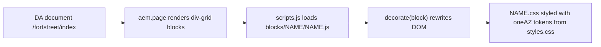

# Benchmark report: Fort Street High School to AEM EDS (oneAZ Figma reskin)

| | |
|---|---|
| Source page | https://fortstreet-h.schools.nsw.gov.au/ |
| Design system | Figma oneAZ Design System v3.2 (`rsZQmpVzuyn0KhCDA3WN60`, node 6400-21997) |
| Migrated EDS page | https://fs-oneaz--stardust-figma-migration--sanyasandal.aem.page/fortstreet/ |
| Code branch | `fs-oneaz` (commits 97c41ea, 6c7b4bd) |
| DA content | `sanyasandal/stardust-figma-migration` at `/fortstreet/{index,nav,footer}` |
| Model | claude-opus-5.5 (GitHub Copilot CLI, stardust + figma-to-eds skills) |

## 1. Summary

| Metric | Result | Evidence |
|---|---|---|
| **Overall fidelity** | **89.2 %** (weighted composite, formula in §2.4) | this report |
| Content fidelity (text, images, links) | **98.6 %** text; 100 % images (15/15); 100 % links (13/13) | `content-parity.json` |
| Design fidelity to Figma (oneAZ spec) | **100 %** (28/28 checks) | `spec-conformance.json` |
| Visual similarity to source, desktop 1440 px | **67.7 %** pixel / 66.0 % colour / 24.8 % SSIM | `fidelity-visual.json` |
| Visual similarity to source, mobile 390 px | **60.8 %** pixel / 69.5 % colour / 5.5 % SSIM | `fidelity-visual.json` |
| Input tokens | 17,463,747 (16,471,710 cache-read; 991,735 cache-write) | `usage.json` |
| Output tokens | 136,953 (39,854 of them reasoning) | `usage.json` |
| API calls | 137 | `usage.json` |
| Cost | 1,099.33 AI units. **USD: unavailable** | `usage.json` |
| Time, wall clock | 1 h 53 m 42 s (10:39:23Z to 12:33:05Z, including waits on user and permission prompts) | `usage.json` |
| Time, model compute | 24 m 14 s (1,453.9 s) | `usage.json` |
| Prompts | 4 user prompts. System prompt: **not disclosed** | `prompts.md` |

## 2. Fidelity

### 2.1 How to read these numbers

This is a **reskin**, not a replica. The content comes from the Fort Street site; the visual design is deliberately replaced by the oneAZ Figma design system. Fonts, colours, buttons, cards and spacing are all meant to change. Pixel similarity to the source therefore **should** be well below 100 %. A high value there would mean the Figma design was *not* applied. Fidelity is therefore measured on three axes:

1. **Content fidelity**: does the migrated page carry the same content as the source?
2. **Design fidelity**: does the page implement the Figma spec exactly?
3. **Visual similarity to source**: how close are the screenshots at the same viewport? (Reported for transparency.)

### 2.2 Visual similarity: screenshot comparison at the same viewport

Method:
- Headless Chrome, full-page capture at 1440 px and at 390 px, with trailing blank background cropped.
- Both images resized to a common grid: 240×960 for desktop, 120×1440 for mobile.
- Pixel similarity = 1 − mean absolute RGB difference / 255.
- SSIM = grayscale, 8×8 windows.
- Colour = 512-bin RGB histogram intersection.
- Rhythm = correlation of 60-band row luminance.

| Viewport | Source px | Migrated px | Height ratio | Pixel similarity | SSIM (structure) | Colour histogram | Vertical rhythm r |
|---|---|---|---|---|---|---|---|
| Desktop 1440 | 1440×6094 | 1440×5547 | 0.91 | **67.7 %** | 24.8 % | 66.0 % | 0.12 |
| Mobile 390 | 390×8312 | 390×9351 | 1.13 | **60.8 %** | 5.5 % | 69.5 % | −0.20 |

Artifacts in `screenshots/`:
- `source-{1440,390}.png`
- `migrated-{1440,390}.png`
- `side-by-side-{1440,390}.png` (source left, migrated right)
- `diff-heatmap-{1440,390}.png`

Low SSIM and rhythm values are expected. Section heights and paddings follow the oneAZ 8-pt spacing scale, so blocks move vertically and the windows no longer line up. The colour overlap of about 66-70 % comes from the shared white and off-white backgrounds and the photography; the accent colour changes from maroon `#630019` to oneAZ mulberry `#830051` and magenta `#d0006f`.

### 2.3 Key differences (source to migrated)

These are observed in `side-by-side-1440.png`. The dominant colours were sampled from the screenshots.

| Area | Source (observed) | Migrated (oneAZ) | Mandated by |
|---|---|---|---|
| Colour | Maroon `#630019` brand, grey `#f2f2f2` panels, white | Mulberry `#830051` titles and dark sections, magenta `#d0006f` buttons, Supporting-1 `#ebefee` panels, body `#3c4242` | Figma foundation/colour |
| Typography | Sans-serif (Public Sans) headings and body | oneAZ heading face (serif fallback rendered) in mulberry; sans body; Figma H1–H6/body ramp | Figma foundation/type |
| Header | Crest logo, motto, search icon, grey nav bar | Single-line text header with flat nav and chevrons; hamburger below 900 px | oneAZ Header |
| Hero | Full-bleed photo with white overlay text card | Split hero: Supporting-1 text panel left, image right, magenta CTA | oneAZ Hero |
| "Difference" cards | 3 solid maroon cards, white text, arrow link | 3 light teaser cards: image, mulberry title, body; no arrow | oneAZ Teaser Card |
| Principal's message | Grey section with portrait | Same layout (`columns`) on Supporting-1 with magenta CTA | oneAZ section styles |
| Fort Fest / Key dates | Image + text row on white | Same composition (`banner`), magenta CTA pill | oneAZ Banner |
| School tours | Maroon band | Mulberry `dark` section | oneAZ dark section |
| Quick links | 3×2 bordered cards with arrows | 3×2 `cards supplementary`, grey body, mulberry titles, no arrows | oneAZ Supplementary card |
| Ready to apply | Maroon band, large image left | Mulberry band containing a white bordered `banner cta` card with a small image | oneAZ Banner (CTA) |
| Socials | 3 Facebook post cards | `facebook-feed` iframe embed plus a "Follow us on Facebook" link. The iframe is blank in headless capture. | Social embed |
| Footer | Maroon footer, icons, NSW logo | White footer: 3 columns plus Acknowledgement of Country | oneAZ Footer |
| Page height | 6,094 px (1440) / 8,312 px (390) | 5,547 px (−9 %) / 9,351 px (+12.5 %) | oneAZ spacing scale |
| Content | — | Same: 584/590 words, all 15 images and 13 links; one empty source `h3` dropped; Facebook link added | content-parity |

### 2.4 Composite fidelity score

```
overall = 0.40 × content + 0.30 × figma_design + 0.30 × visual_to_source
        = 0.40 × 98.6    + 0.30 × 100.0       + 0.30 × 66.0
        = 89.2 %
```

`visual_to_source` = mean of pixel similarity and colour histogram at both viewports = (67.7 + 60.8 + 66.0 + 69.5) / 4 = 66.0 %. SSIM is excluded from the composite because the reskin changes layout by design. It is reported above for completeness. The weights are this report's own choice; the component values are measured.

### 2.5 Figma spec conformance (28/28)

| Category | Checks | Pass |
|---|---|---|
| Colour tokens | 5 | 5 |
| Typography ramp | 6 | 6 |
| Layout / grid | 2 | 2 |
| Components (hero, cards, banner, buttons, header, footer…) | 15 | 15 |

## 3. How the blocks are formed

Content is authored in DA as div-grid blocks. Each EDS block's `decorate()` function turns the authored rows into the semantic DOM, and the block CSS styles it using only the oneAZ custom properties declared in `styles/styles.css`.



| Block (authored class) | Used | Authored content model (rows × cells) | `decorate()` output | oneAZ styling (tokens) | Figma module |
|---|---|---|---|---|---|
| `hero` | 1 | 1 row: picture + h1 + text + CTA links | Splits into `.hero-content` (text) and `.hero-media` (picture); adds `no-media` when there is no image | Mulberry title colour, Display/H1 ramp, primary pill button | Hero |
| `cards` | 1 | n rows × [image, h3 + text + link] | Builds `ul > li`, with `.cards-card-image` and `.cards-card-body` | Teaser card: Supporting-1 body, mulberry title, body ramp | Teaser Card |
| `cards supplementary` | 1 | n rows × [h3 + link] | Same `ul > li`; the variant class switches to the text-only 3-col grid at ≥900 px | Supporting-1 background, 3×2 grid | Supplementary card |
| `banner` | 1 | 1 row × [text, picture] | Wraps `.banner-content` and `.banner-media`; adds `image-left`/`image-right` from cell order, or `no-media` | Image/text row, H2, magenta pill button | Banner |
| `banner cta` | 1 | 1 row × [text + CTA] | As above with the CTA emphasis variant | White bordered card inside mulberry `dark` section, magenta pill CTA | Banner (CTA) |
| `columns` | 3 | 1 row × 2 cells (text / picture) | Adds `columns-2-cols`; marks image cells `columns-img-col` | 8-pt gutter scale, body ramp | Text + media |
| `facebook-feed` | 1 | 1 row: page URL link | Creates an iframe embed plus a fallback link; marks the section `facebook-feed-empty` if there is no URL | Card frame, H3 | Social embed |
| `header` (auto) | page | `/fortstreet/nav` fragment: brand / sections / tools | Builds `<nav>` with drop-downs and a hamburger (below 900 px) | oneAZ header spec | Header |
| `footer` (auto) | page | `/fortstreet/footer` fragment | Footer columns plus legal row | Dark footer tokens | Footer |
| `section-metadata` | 4 | `style` = `white` / `off-white` / `dark` | Adds the section classes | Section background tokens | Section styles |
| `metadata` | 1 | title, description, nav, footer | Page `<meta>` | — | — |

The source-to-block mapping is in `stardust/figma-to-eds/mapping.md`, and the full token sheet is in `stardust/reskin/donor-tokens.json`.

## 4. Unavailable or estimated values

| Value | Status |
|---|---|
| USD cost | **Unavailable**: usage is metered in AI units (1,099.33 AIU) |
| System prompt text | **Not disclosed** (confidential) |
| Cloud `session_usage` | **Unavailable**: 0 rows; the local `assistant_usage_events` table was used |
| Tokens of this final report turn | Not included (it ran after the query) |
| Composite fidelity weights | Chosen by the report author; the component metrics are measured |

## 5. Artifacts

| File | Contents |
|---|---|
| `benchmark-report.md` | This report |
| `prompts.md` | Exact user prompts, follow-ups, retries and denials |
| `usage.json` | Token, cost and time evidence |
| `fidelity-visual.json` | Screenshot similarity metrics |
| `content-parity.json` | Text, image, link and heading parity |
| `spec-conformance.json` | 28 Figma spec checks |
| `screenshots/` | Source, migrated, side-by-side and diff heatmaps at 1440 and 390 |

## 6. DA block library (excat `block-library-creator`, DA path)

| Item | Result |
|---|---|
| Library panel config | `POST admin.da.live/config/sanyasandal/stardust-figma-migration/` returned 201. A fresh config was written because the GET returned 404 (no prior sheets). `library` sheet: `Blocks` points to `library/blocks.json` |
| Block index | https://content.da.live/sanyasandal/stardust-figma-migration/library/blocks.json (6 entries; 201) |
| Sample pages | `library/blocks/{banner,cards,columns,facebook-feed,fragment,hero}` (201 each). Uploaded by the agent because DA writes were authorized; the skill's default is a manual upload |
| Placeholders | `library/blocks/images/placeholder-{16x9,4x3}.png` (201) |
| Variants | `cards` + `cards supplementary`; `banner` + `banner cta` |
| Sample source | Reference page `/fortstreet/index` for 5 blocks; `fragment` synthesized from its JS |
| metadata.json | Created for the 6 in-scope blocks (inferred fields only) |
| Skipped | `widget`: there are no `/widgets/*` implementations to render. `header` and `footer` are page chrome |
| Local copies | `content/library/` (hlxignored) |
